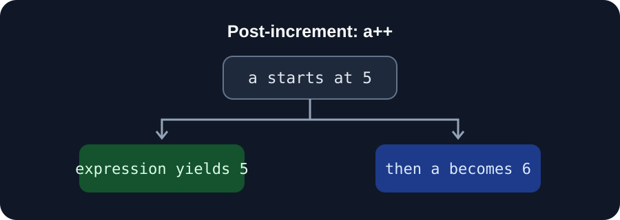

# Learn Playwright

This repository contains small JavaScript examples used while learning the
fundamentals that support browser automation.

## Chapter 001: JavaScript basics

The [`Chapter001`](./Chapter001/) folder contains examples for:

- Printing values and performing arithmetic
- Declaring variables and inspecting value types
- Using a ternary operator to choose a value
- Using the post-increment operator

### Ternary operator

The ternary operator evaluates a condition and returns one of two values:


In [`05_ternary_op.js`](./Chapter001/05_ternary_op.js), the condition is
`age > 18`. Since `age` is `15`, the expression evaluates to `false`.

### Post-increment operator

The post-increment operator (`a++`) evaluates to the variable's current value,
then increases the variable by one:



In [`06_increment.js`](./Chapter001/06_increment.js), `a++` evaluates to `5`
before `a` becomes `6`, so the two logged values are `5` and `6`.

Run an example with Node.js from the repository root:

```sh
node Chapter001/06_increment.js
```
